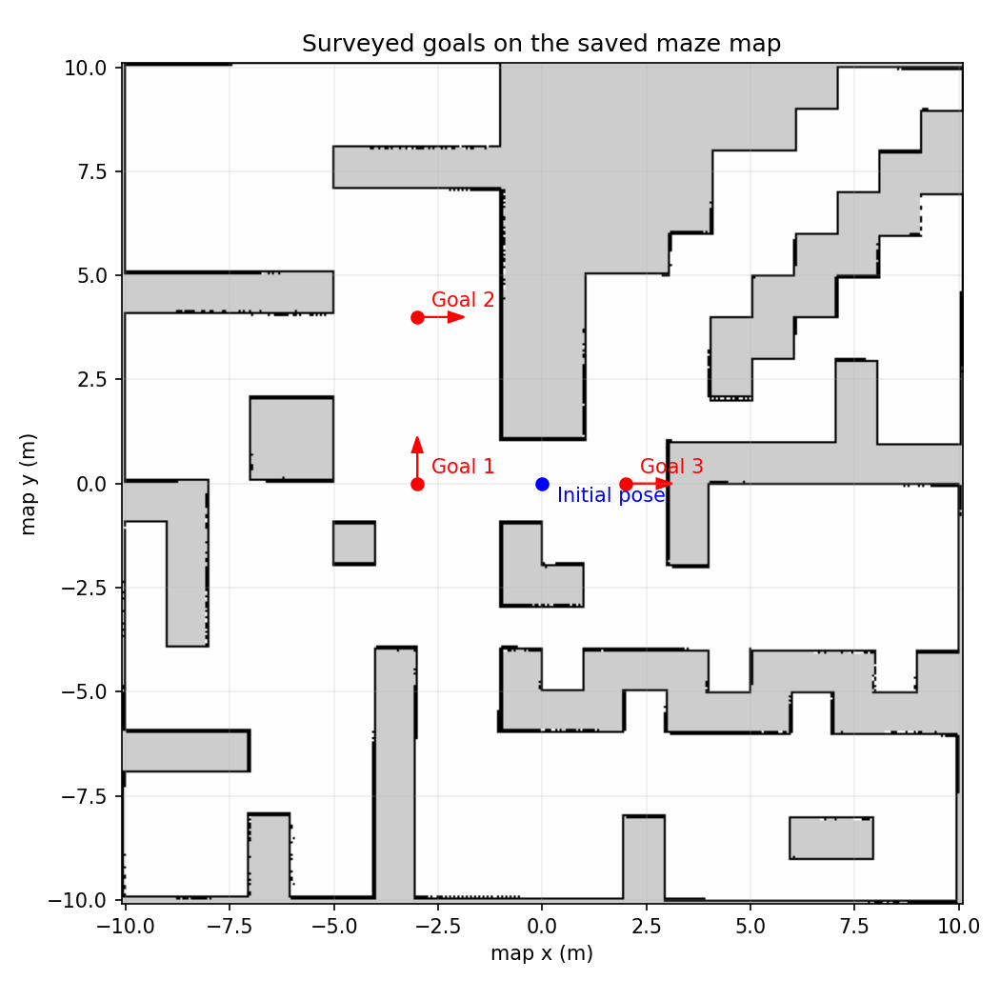
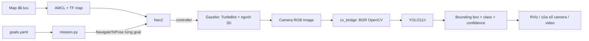

# TurtleBot 4: ba navigation goal và nhận diện YOLO

Bài này dùng lại `maps/map.yaml` và `maps/map.pgm` đã quét trong world `maze`.
Không chạy SLAM và không tạo lại bản đồ. Robot định vị bằng AMCL, sau đó node
Python gửi tuần tự các action Nav2 trong khi node khác xử lý camera bằng YOLO11n.

## Chuẩn bị

Ubuntu 22.04 + ROS 2 Humble và simulator của bài trước cần có sẵn.

```bash
sudo apt install ros-humble-turtlebot4-navigation ros-humble-nav2-simple-commander \
  ros-humble-cv-bridge python3-venv
cd ~/ros2_ws
./setup_vision.bash
```

Script cài PyTorch CPU và Ultralytics vào `.venv-yolo/` có quyền truy cập package
ROS hệ thống. NumPy được giữ ở `1.26.4` để tương thích `cv_bridge` của Humble;
OpenCV `4.11.0.86`, PyTorch CPU `2.5.1`, torchvision `0.20.1`, Ultralytics `8.3.203`.
YOLO11n được tải từ Ultralytics vào `.models/yolo11n.pt`. Cài lần đầu cần mạng;
những lần chạy sau dùng weights đã tải. Không cần cài CUDA.
Để dùng script ghi màn hình, cài thêm `ffmpeg x11-utils` nếu máy chưa có.

## Một lệnh chạy toàn bộ

```bash
cd ~/ros2_ws
./stop_turtlebot4.bash
./run_vision_demo.bash
```

Giữ terminal này chạy. Launch mở Gazebo, load map, AMCL, Nav2, RViz và cửa sổ
**TurtleBot 4 - YOLO RGB Camera**. Ba mô hình người 3D được đặt trong Gazebo,
ngoài các goal, để có vật thể thật trong ảnh camera. LiDAR và Nav2 quan sát
các vật thể mới như vật cản động của môi trường; bản đồ gốc được giữ nguyên.

Đợi khoảng một phút khi khởi động: model 3D/YOLO được nạp trước, AMCL bắt đầu
sau 30 giây, Nav2 sau 45 giây. Node nhiệm vụ bắt đầu sau 50 giây và tiếp tục
đợi đầy đủ lifecycle `active`, map/TF và khung hình YOLO đầu tiên.

Sau đó robot tự undock và đi lần lượt Goal 1 → Goal 2 → Goal 3. Sau khi node
đã bắt đầu nhiệm vụ, không mở teleop hoặc đặt goal bằng chuột. Kết quả mỗi
goal in ra terminal; `MISSION_COMPLETE` nghĩa là cả ba goal đều SUCCEEDED.
Nếu goal thất bại/timeout hoặc có bumper contact, nhiệm vụ dừng và ghi lỗi.

Trong RViz quan sát:

- Fixed frame `map`, robot, LiDAR `/scan` và map đã nạp.
- Ba marker goal và đường đi/costmap của Nav2.
- Image **Camera RGB**: `/oakd/rgb/preview/image_raw`.
- Image **YOLO Detections**: `/yolo/image_annotated`.

Cửa sổ YOLO thể hiện ảnh camera có bounding box, tên class, confidence và
trạng thái nhiệm vụ. Đây là ảnh từ sensor của robot qua `cv_bridge`; vị trí
spawn vật thể không được dùng làm kết quả nhận diện. YOLO pretrained có thể
nhận nhầm hoặc bỏ sót vật thể trong ảnh tổng hợp; log giữ nguyên đầu ra model.

## Tọa độ mục tiêu

File [goals.yaml](src/turtlebot4_vision_nav/config/goals.yaml) chứa:

| Goal | x (m) | y (m) | yaw (rad) |
|---|---:|---:|---:|
| Goal 1 | -3.0 | 0.0 | 1.570796 |
| Goal 2 | -3.0 | 4.0 | 0.0 |
| Goal 3 | 2.0 | 0.0 | 0.0 |



Các tọa độ nằm trong hệ `map`, được chọn ở những vùng trống đã khảo sát.
Node kiểm tra goal thuộc ô đã biết và không occupied trước khi chạy.
Yaw được đổi thành quaternion bằng `z=sin(yaw/2)`, `w=cos(yaw/2)`.

Để khảo sát/chọn goal riêng trước khi chạy nhiệm vụ:

```bash
./run_vision_demo.bash autostart_mission:=false
```

Mở terminal khác:

```bash
cd ~/ros2_ws
source turtlebot4_env.bash
ros2 run turtlebot4_vision_nav record_goals.py --ros-args \
  -p output_file:=$HOME/ros2_ws/my_goals.yaml -p yaw:=0.0
```

Dùng **Publish Point** trên RViz, click ít nhất ba vùng trống. Node lưu các
điểm vào YAML, không gửi lệnh di chuyển. `Publish Point` cung cấp x/y; đặt
yaw mong muốn trong YAML hoặc qua tham số `yaw` của node ghi tọa độ.
Có thể đọc vị trí/hướng robot bằng:

```bash
ros2 topic echo /clicked_point
ros2 run tf2_ros tf2_echo map base_link --ros-args -p use_sim_time:=true
```

Sau khi chọn xong, dừng phiên khảo sát và chạy:

```bash
./stop_turtlebot4.bash
./run_vision_demo.bash goals_file:=$HOME/ros2_ws/my_goals.yaml
```

Trong một phiên đã mở với `autostart_mission:=false`, cũng có thể bắt đầu
nhiệm vụ bằng node riêng (không cần khởi động lại simulator):

```bash
source turtlebot4_env.bash
ros2 run turtlebot4_vision_nav mission.py --ros-args -p use_sim_time:=true \
  -p goals_file:=$HOME/ros2_ws/my_goals.yaml \
  -p output_dir:=$HOME/ros2_ws/artifacts/manual_vision_mission
```

## Source và luồng dữ liệu

- [mission.py](src/turtlebot4_vision_nav/scripts/mission.py): ROS 2 node,
  `ActionClient(NavigateToPose)` gửi từng goal, chờ kết quả trước khi gửi
  goal kế tiếp, feedback, timeout/cancel và report. Không publish `/cmd_vel`.
- [yolo_detector.py](src/turtlebot4_vision_nav/scripts/yolo_detector.py):
  subscribe `sensor_msgs/Image`, `CvBridge.imgmsg_to_cv2(..., 'bgr8')`,
  `YOLO.predict`, `result.plot`, publish ảnh và JSON, hiển thị/ghi video.
- [record_goals.py](src/turtlebot4_vision_nav/scripts/record_goals.py):
  lưu `/clicked_point` thành file goal, không điều khiển robot.
- [vision_demo.launch.py](src/turtlebot4_vision_nav/launch/vision_demo.launch.py):
  ghép simulator bài trước và các node bài mới.



## Kết quả và video

Đã chạy thành công ba goal liên tiếp và YOLO nhận diện người trong lúc robot
di chuyển. Xem [báo cáo kiểm chứng và ảnh demo](docs/VISION_VALIDATION.md).
[Video demo đã ghi](docs/demo/demo_rviz_yolo.mp4) được đưa kèm repo để tải về.

Mỗi lần chạy tạo thư mục riêng dưới `artifacts/vision_runs/`.
`artifacts/latest_vision_run.txt` chứa đường dẫn lần chạy gần nhất.

- `mission_results.json`: từng tọa độ, status Nav2, vị trí cuối, thời gian,
  bumper detections và kết quả toàn nhiệm vụ.
- `detections.jsonl`: bounding box/class/confidence từng khung hình và trạng thái goal.
- `yolo_summary.json`: số frame, class nhận được và confidence lớn nhất.
- `person_example.png`, `person_rgb.png`: ví dụ nhận diện người và ảnh RGB gốc,
  chỉ được tạo khi model thật phát hiện person với confidence ≥ 0.6.
- `camera_yolo.mp4`: ảnh camera nhận diện và trạng thái nhiệm vụ. File được
  đóng hoàn chỉnh khi dừng demo bằng `./stop_turtlebot4.bash`.

Video camera không thay thế toàn bộ video nộp bài: cần ghi cả RViz/Gazebo để
thấy localization và robot qua đủ ba goal. Khi quay, giữ panel Navigation,
map và cửa sổ YOLO cùng hiển thị; chờ `MISSION_COMPLETE` trước khi dừng.

Đã có công cụ quay hai cửa sổ RViz và YOLO cạnh nhau. Khởi động demo ở terminal
thứ nhất, rồi chạy ở terminal thứ hai ngay khi bắt đầu:

```bash
cd ~/ros2_ws
./record_vision_demo.py
```

Script đợi cửa sổ xuất hiện, ghi bằng ffmpeg, rồi tự kết thúc sau khi nhiệm vụ
hoàn thành 5 giây (tối đa 10 phút). Kết quả là `demo_rviz_yolo.mp4` trong thư mục
lần chạy. Có thể Ctrl+C ở terminal ghi hình để kết thúc sớm. Công cụ dùng X11;
các cửa sổ Qt/XWayland trên máy thực hành đã được kiểm tra.

## Tùy chọn

```bash
./run_vision_demo.bash show_window:=false       # xem ảnh trên RViz
./run_vision_demo.bash scene_objects:=false     # không thêm người 3D
./run_vision_demo.bash autostart_mission:=false # khảo sát, chưa gửi goal
```

Các model người giữ nguồn/metadata upstream trong
[models/ATTRIBUTION.md](src/turtlebot4_vision_nav/models/ATTRIBUTION.md).
Ultralytics code/weights có license riêng; weights và Python environment
không được đưa vào source repo.

## Tài liệu

- [TurtleBot 4 Navigator](https://turtlebot.github.io/turtlebot4-user-manual/tutorials/turtlebot4_navigator.html)
- [Nav2 Humble API](https://api.nav2.org/nav2-humble/html/classnav2__simple__commander_1_1robot__navigator_1_1BasicNavigator.html)
- [Ultralytics Predict](https://docs.ultralytics.com/modes/predict/)
