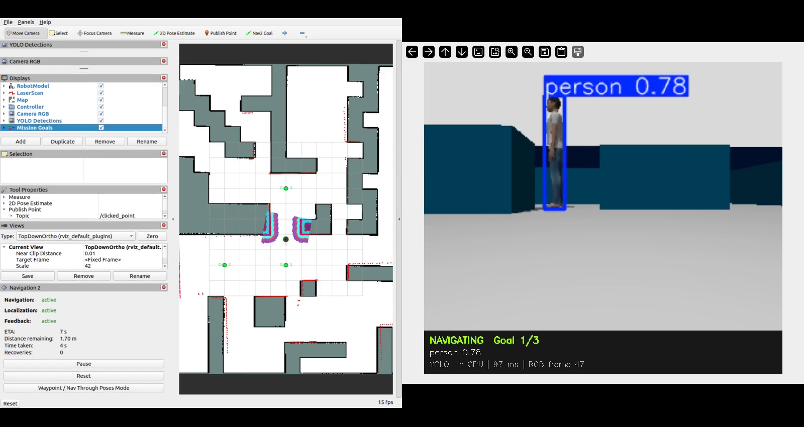

# Kết quả chạy thực tế: Nav2 + YOLO

Kiểm tra trên Ubuntu 22.04, ROS 2 Humble, TurtleBot 4 Lite trong Gazebo
`maze`, ngày 18/10/2026. Dùng lại `maps/map.yaml` và `maps/map.pgm` của bài
trước; không tạo lại hay chỉnh sửa bản đồ. AMCL thiết lập initial pose tại
vị trí spawn của robot, Nav2 lập kế hoạch từ LiDAR và bản đồ đã nạp.

## Điều hướng

Node Python `mission.py` gọi action `/navigate_to_pose` tuần tự. Không dùng
teleop hoặc công cụ Nav2 Goal trong nhiệm vụ. Node đợi AMCL/Nav2 active và
camera YOLO sẵn sàng, thực hiện undock nếu cần, rồi gửi ba goal:

| Goal | x (m) | y (m) | yaw (rad) | Kết quả Nav2 | Thời gian thực | Sai số vị trí Gazebo cuối (m) |
|---|---:|---:|---:|---|---:|---:|
| 1 | -3 | 0 | 1.5708 | SUCCEEDED (4) | 41.66 s | 0.251 |
| 2 | -3 | 4 | 0 | SUCCEEDED (4) | 61.51 s | 0.212 |
| 3 | 2 | 0 | 0 | SUCCEEDED (4) | 93.52 s | 0.178 |

Cả ba goal thành công trong cùng một lần chạy, không ghi nhận bumper
contact. Kết quả dựa trên status action; sai số Gazebo được ghi để đối chiếu,
không dùng ground truth để điều khiển robot. Bumper bằng 0 là bằng chứng từ
sensor, không phải phép chứng minh hình học rằng mọi bề mặt đều không tiếp xúc.


## Nhận diện thật từ camera RGB

YOLO11n đọc `/oakd/rgb/preview/image_raw` qua `cv_bridge`; inference trên CPU,
publish `/yolo/image_annotated` và `/yolo/detections`. Đã thêm ba mesh người
3D thật từ OSRF Gazebo models vào môi trường. Bounding box, class và confidence
đều lấy từ model, không tạo detection theo vị trí vật thể.

- Xử lý 217 khung hình; 62 khung hình có detection.
- Có 60 detection `person`, confidence lớn nhất **0.926**.
- Trong trạng thái `NAVIGATING`, có người trong 22 khung hình ở Goal 1
  và 29 khung hình ở Goal 2. Không ghi nhận person khi đang tới Goal 3.
- Có 3 detection `traffic light` sai trên chi tiết môi trường/dock,
  confidence cao nhất 0.488. Không coi các detection này là nhận diện đúng.
- Lần inference cuối khoảng 71 ms. Đây không phải phép đo benchmark toàn phiên.

Phiên bản đã chạy: Python 3.10, torch 2.5.1+cpu, torchvision 0.20.1+cpu,
ultralytics 8.3.203, NumPy 1.26.4, opencv-python 4.11.0.86 và cv_bridge hệ thống.
Giữ NumPy dưới 2 để tương thích cv_bridge Humble.



## Video và dữ liệu gốc

Bản demo được đưa kèm repo:
[video RViz + YOLO](demo/demo_rviz_yolo.mp4),
[mission_results.json](demo/mission_results.json) và
[yolo_summary.json](demo/yolo_summary.json).

Thư mục bằng chứng cục bộ:
`artifacts/vision_runs/20261018_085440/`.

- `demo_rviz_yolo.mp4`: RViz và cửa sổ YOLO cạnh nhau, H.264,
  **1600 × 850, 312.375 giây**; xem localization, đường đi và ba goal.
- `camera_yolo.mp4`: luồng ảnh nhận diện riêng, 800 × 696, 108.5 giây.
  Ghi theo nhịp xử lý ảnh, không thể dùng thời lượng này để đo thời gian chạy robot.
- `mission_results.json`: kết quả từng action và vị trí cuối.
- `detections.jsonl`, `yolo_summary.json`: output inference thực tế.
- `person_example.png`, `person_rgb.png`: ảnh nhận diện và ảnh gốc.

Video/dữ liệu từng phiên nằm trong `.gitignore`; chúng có trên máy thực hành.
Bản video và hai báo cáo đã kiểm chứng được sao chép riêng vào `docs/demo/`
để người xem repo tải về.
Chạy lại sẽ tạo thư mục phiên mới. Xem [hướng dẫn chạy và quay video](../README_VISION_NAV.md).

## Kiểm tra bổ sung

Đã build hai package bằng colcon, kiểm tra cú pháp Python/Bash, kiểm tra
launch arguments và giải mã toàn bộ video demo bằng ffmpeg.
Ba tọa độ goal nằm trong ô free của bản đồ đã nạp; map và TF đã hoạt động
trong lần chạy thành công. RViz đã hiển thị map, robot, LiDAR và ảnh RGB;
cửa sổ OpenCV hiển thị ảnh nhận diện trong toàn nhiệm vụ.

SHA-256 của bản đồ sử dụng:

```text
map.yaml  0fed3f2048a73f1f005385ecfab30ad57aa262d5ce171d121ba9de0bfd5f6f84
map.pgm   b5ef63d3e4f9a434b3d253102be5d969a30321037963fc0250c7851211080ac7
```
